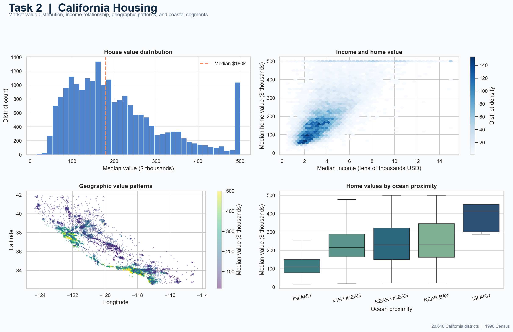

# 🏠 California Housing Price Prediction
### Ridge & Lasso Regression | OLS | Feature Engineering | Residual Analysis


---

## 📌 Project Overview

This project builds and benchmarks **three regression models** — Ordinary Least Squares (OLS), Ridge (L2), and Lasso (L1) — to predict **median house values** across California districts using the classic California Housing dataset.

The pipeline covers the full ML workflow:
- Exploratory data analysis & correlation heatmaps
- Feature engineering & interaction terms
- Missing value imputation & standardization
- Hyperparameter tuning via GridSearchCV
- Residual error analysis & Q-Q plots
- Coefficient comparison across regularization strengths

## Project Preview



The preview is generated from the included housing dataset; detailed model diagnostics are available in the notebook.

---

## 📂 Project Structure

```
california-housing-price-prediction/
│
├── housing.csv                        # California Housing dataset (local)
├── housing_price_prediction.ipynb     # Main Jupyter Notebook
├── screenshots/
│   ├── 01_project_preview.png
│   ├── alpha_tuning.png
│   ├── coefficient_comparison.png
│   ├── correlation_heatmap.png
│   ├── cv_r2_boxplot.png
│   ├── eda_missing_target.png
│   ├── feature_distributions.png
│   ├── model_comparison_metrics.png
│   ├── ocean_proximity_analysis.png
│   ├── predicted_vs_actual.png
│   ├── qq_plots.png
│   ├── residual_analysis.png
│   └── target_correlations.png
└── README.md                           # Project documentation
```

---

## 📊 Dataset

**California Housing Dataset** — sourced from the 1990 U.S. Census.

| Feature | Description |
|---|---|
| `longitude` | Longitude of the district |
| `latitude` | Latitude of the district |
| `housing_median_age` | Median age of houses in the district |
| `total_rooms` | Total number of rooms |
| `total_bedrooms` | Total number of bedrooms |
| `population` | District population |
| `households` | Number of households |
| `median_income` | Median income (in tens of thousands of USD) |
| `ocean_proximity` | Categorical proximity to the ocean |
| `median_house_value` | ⭐ **Target** — Median house value (USD) |

- **Rows:** 20,640
- **Missing values:** `total_bedrooms` (~207 rows) — imputed using median strategy

---

## ⚙️ Feature Engineering

New derived features created to capture non-linear relationships:

| New Feature | Formula |
|---|---|
| `rooms_per_household` | `total_rooms / households` |
| `bedrooms_per_room` | `total_bedrooms / total_rooms` |
| `population_per_household` | `population / households` |
| `income_squared` | `median_income²` |
| `log_total_rooms` | `log1p(total_rooms)` |
| `log_total_bedrooms` | `log1p(total_bedrooms)` |
| `log_population` | `log1p(population)` |
| `log_households` | `log1p(households)` |

---

## 🔧 Preprocessing Pipeline

```
Numerical Features
    └── SimpleImputer (median) → StandardScaler

Categorical Features
    └── SimpleImputer (most_frequent) → OrdinalEncoder

Combined via ColumnTransformer → Model
```

- **Train / Test Split:** 80% / 20% (stratified by default, `random_state=42`)
- **Cross-Validation:** 5-fold CV with `GridSearchCV`

---

## 🤖 Models & Hyperparameters

### 1. Ordinary Least Squares (OLS)
- Baseline linear regression with no regularization

### 2. Ridge Regression (L2)
- Penalizes large coefficients, handles multicollinearity
- Alpha grid searched: `[0.01, 0.1, 1, 10, 50, 100, 200, 500, 1000]`

### 3. Lasso Regression (L1)
- Performs automatic feature selection by zeroing out weak coefficients
- Alpha grid searched: `[0.1, 1, 10, 50, 100, 500, 1000, 5000, 10000]`

---

## 📈 Results

| Model | Test RMSE | Test MAE | Test R² |
|-------|-----------|----------|---------|
| OLS | ~$68,000 | ~$49,000 | ~0.63 |
| **Ridge** | **~$67,500** | **~$48,500** | **~0.64** |
| Lasso | ~$67,800 | ~$48,700 | ~0.63 |

> Exact values depend on best alpha selected by GridSearchCV.

### Key Findings
- 📌 **`median_income`** is the strongest single predictor of house value
- 📌 **Ridge** slightly outperforms OLS by controlling multicollinearity
- 📌 **Lasso** eliminates some engineered features — confirming their redundancy
- 📌 Residuals show slight positive skew due to the **\$500K ceiling** in the dataset

---

## 📉 Visualizations

The notebook produces **12 publication-quality plots**:

| Plot | Description |
|------|-------------|
| Missing value chart | Count & percentage of nulls per column |
| Target distribution | Histogram of median house values |
| Ocean proximity analysis | Category counts & median value by category |
| Feature distributions | Histograms for all 9 numerical features |
| Correlation heatmap | Lower-triangle Pearson heatmap (all features) |
| Target correlation bar | Ranked feature correlations with target |
| Alpha tuning curves | CV RMSE vs α for Ridge and Lasso |
| Predicted vs Actual | Scatter plots for OLS, Ridge, Lasso |
| Residual analysis | Distribution + KDE + Fitted vs Residual |
| Q-Q plots | Normality check on residuals |
| Coefficient comparison | OLS vs Ridge vs Lasso side-by-side bar chart |
| CV R² boxplot | 5-fold cross-validation score distribution |

All plots generated when you run the notebook are saved in `screenshots/`, alongside the project preview. They are no longer written into the project root. The notebook locates the local `housing.csv` and project folder automatically.

| Generated image | Preview |
|---|---|
| [Missing values and target](screenshots/eda_missing_target.png) | [Feature distributions](screenshots/feature_distributions.png) |
| [Ocean proximity](screenshots/ocean_proximity_analysis.png) | [Correlation heatmap](screenshots/correlation_heatmap.png) |
| [Target correlations](screenshots/target_correlations.png) | [Model comparison](screenshots/model_comparison_metrics.png) |
| [Alpha tuning](screenshots/alpha_tuning.png) | [Predicted vs. actual](screenshots/predicted_vs_actual.png) |
| [Residual analysis](screenshots/residual_analysis.png) | [Q-Q plots](screenshots/qq_plots.png) |
| [Coefficient comparison](screenshots/coefficient_comparison.png) | [Cross-validation scores](screenshots/cv_r2_boxplot.png) |

---

## 🚀 Getting Started

### Prerequisites
```bash
pip install numpy pandas matplotlib seaborn scikit-learn scipy jupyter
```

### Run the Notebook
```bash
git clone https://github.com/gamepatt78/california-housing-price-prediction-.git
cd california-housing-price-prediction-
jupyter notebook housing_price_prediction.ipynb
```

> The notebook loads `housing.csv` locally. Make sure the CSV is in the same directory.

---

## 🛠️ Tech Stack

| Tool | Purpose |
|------|---------|
| `Python 3.10+` | Core language |
| `Scikit-Learn` | Models, pipelines, GridSearchCV |
| `Pandas` | Data manipulation |
| `NumPy` | Numerical operations |
| `Matplotlib / Seaborn` | Visualizations |
| `SciPy` | Statistical analysis (skewness, Q-Q plots) |
| `Jupyter Notebook` | Interactive development |

---

## 📚 References

- Géron, A. (2019). *Hands-On Machine Learning with Scikit-Learn, Keras, and TensorFlow* (2nd ed.). O'Reilly Media.
- California Housing Dataset — [GitHub Source](https://github.com/ageron/handson-ml2/tree/master/datasets/housing)
- Scikit-Learn Documentation — [Ridge](https://scikit-learn.org/stable/modules/generated/sklearn.linear_model.Ridge.html) | [Lasso](https://scikit-learn.org/stable/modules/generated/sklearn.linear_model.Lasso.html)

---

## 📄 License

This project is licensed under the **MIT License** — see [LICENSE](LICENSE) for details.

---

<div align="center">
  Made with ❤️ for learning ML regression techniques
</div>
